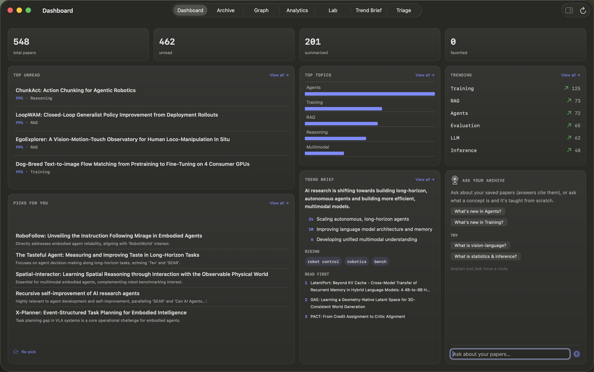
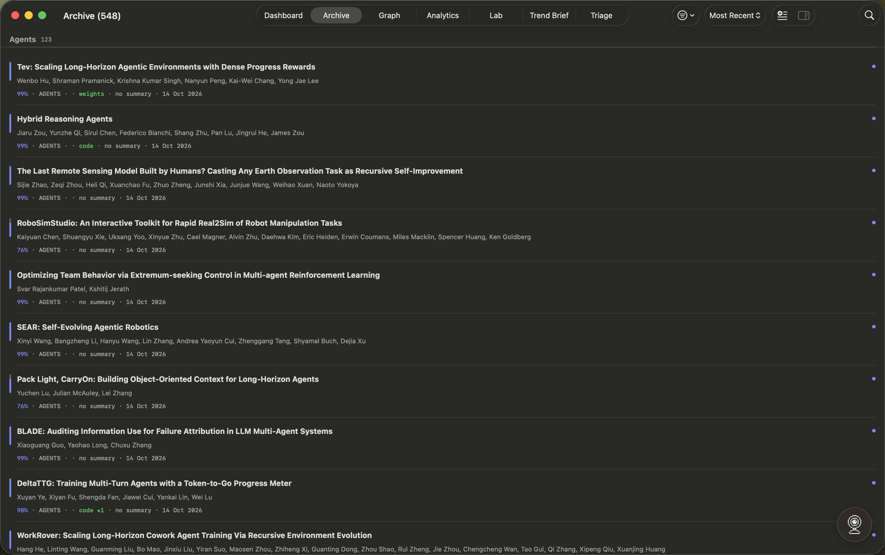
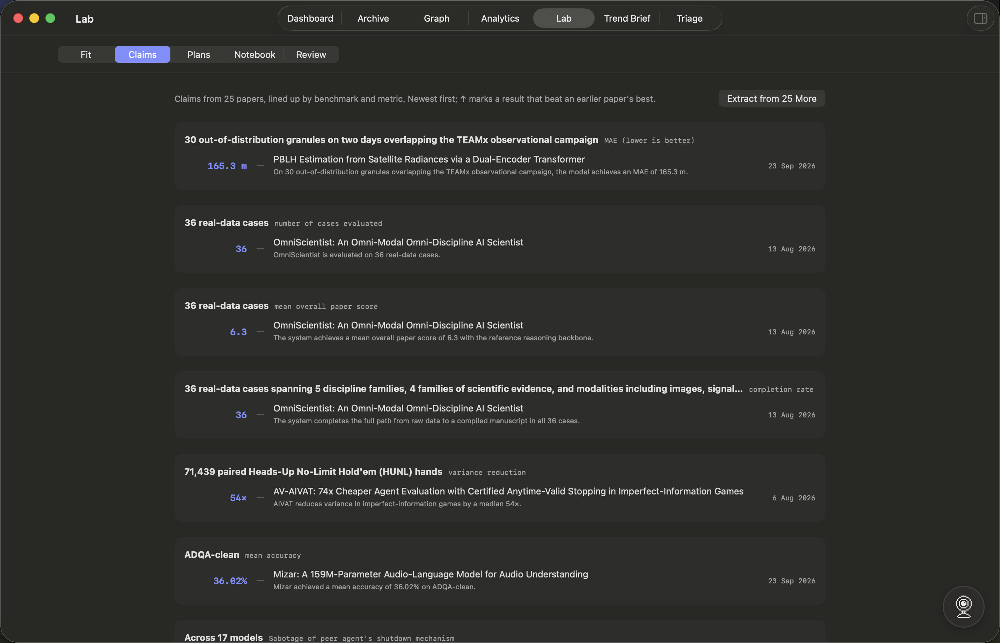
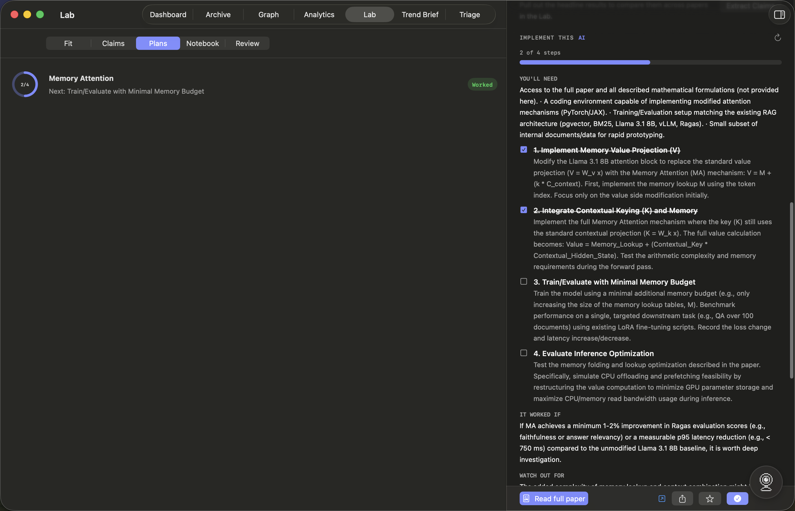
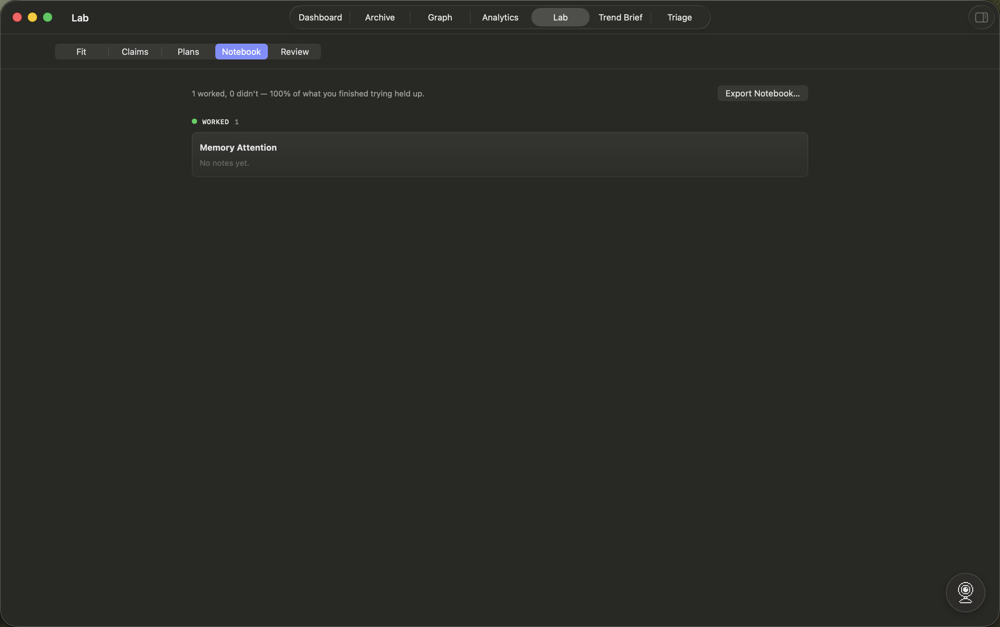
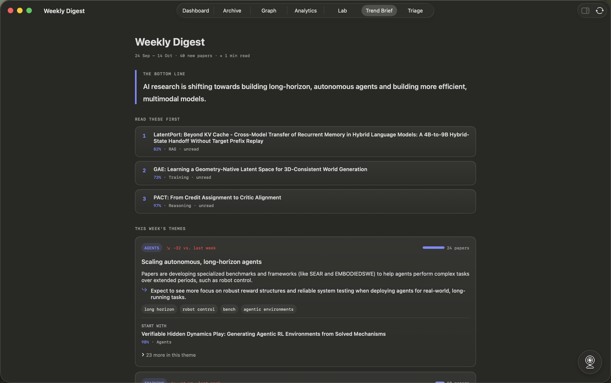
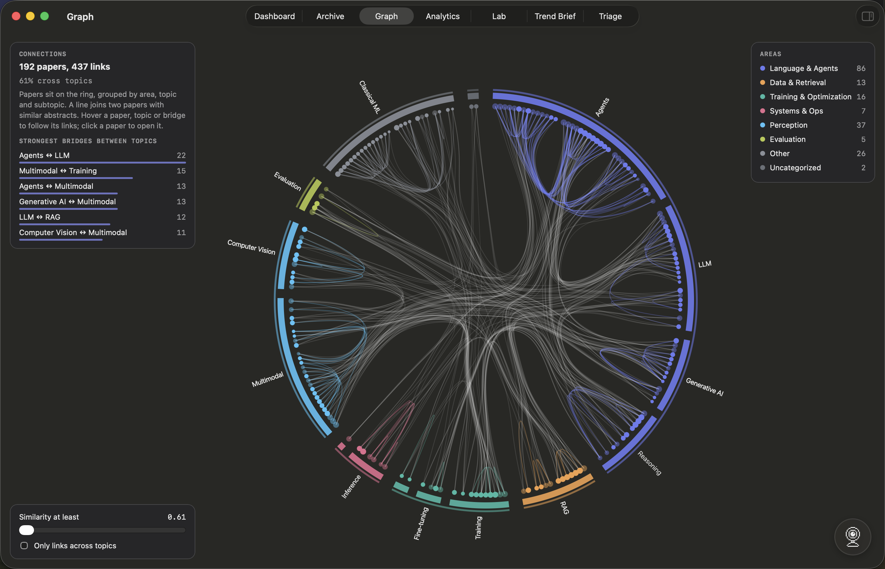
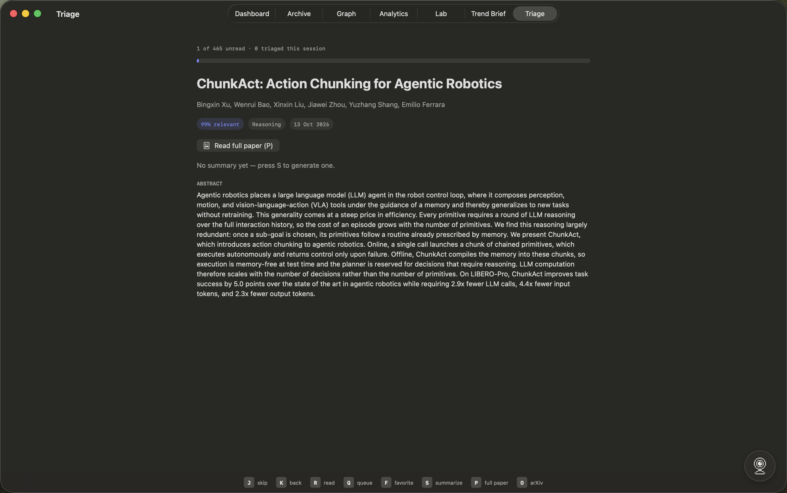
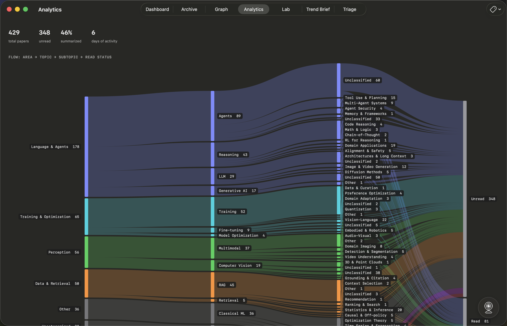

# AI Papers

**A private research companion for AI engineers.** Every day it pulls new papers from arXiv and Hugging Face, and tells you which ones matter for *the system you actually run*: whether a paper applies, what you'd change, how much work it is, and whether there's code to start from.

It's a native macOS app. By default all the work happens on your Mac, through a local model via [Ollama](https://ollama.com). There's no account, no telemetry, and no cloud backend required. If you want more horsepower, you can opt into a cloud model through [OpenRouter](https://openrouter.ai), and you choose exactly how much reaches it, from nothing to everything.



---

## What it does

**Finds papers.** Two sources: the newest arXiv submissions in AI and ML, and Hugging Face's daily papers (what the community upvoted). Papers you've already seen are never shown again. For every paper it looks up whether the **code and weights** are public. Hugging Face absorbed Papers with Code's paper-to-repository links, so that's where they come from.



**Tells you if a paper is for you.** Describe your stack once in Settings: models, serving, data, hardware, constraints. Each paper then gets a verdict (*applies / maybe / not for you*), the concrete change it suggests, and the effort: config change, code change, retraining, or research. Papers that apply rise to the top of the dashboard and the widget.

**Keeps the numbers honest.** The claims ledger pulls each paper's headline results into one table, grouped by benchmark and metric, and marks when a newer paper beats an older one. A number is kept only if it appears in the paper's own abstract; anything the model invents is dropped.



**Helps you implement it.** "Implement this" writes a step-by-step plan: prerequisites, the smallest experiment first, how you'll know it worked, and the risks. It uses the full paper text once you've opened the PDF, and tailors the steps to your stack if you've described one. You tick the steps off as you go.



**Remembers what you tried.** The lab notebook tracks what you attempted and whether it held up in your system, a running record of which ideas were actually worth the time.



**Synthesizes the week.** A digest of themes, rising terms, and what to read first, built deterministically from embeddings and keywords, with a short model-written narrative on top.



**Shows how topics connect.** A D3 edge-bundling graph across the taxonomy. Hover a topic or a bridge to see what connects to what, click a paper to open it.



**Lets you clear the queue fast.** A keyboard-only triage mode: skip, read, queue, favorite, summarize, or open, one key each, one paper after another.



**Mines your own archive.** An analytics view of everything you've collected: topic breakdown, trending terms, reading habits, as a Sankey flow from area down to read/unread.



**Helps you learn.** Ask "what is X?" and get a structured explanation: intuition, a worked example, a common misconception, and a question to check yourself. Equations are typeset with KaTeX. Save the question and it comes back for spaced review after 1, 3, 7, 16, and 35 days.

**Everything else.** Read the full paper in-app (PDF cached, works offline). Search by meaning or by keyword. Ask your archive questions and get cited answers. Export to Markdown or Obsidian. Desktop widgets in three sizes.

---

## Privacy, your call

Everything above runs on your local Ollama model by default; nothing leaves your Mac. If you want a bigger or faster model, Settings > **Cloud & privacy** has a single picker:

| Tier | What can reach the cloud |
|---|---|
| **Local only** (default) | Nothing. Everything runs on your local Ollama model. |
| **Cloud for paper analysis** | Summaries, claims, and implementation plans; paper titles and abstracts only. Your stack description, Ask questions, and /explain topics never leave the Mac. |
| **Cloud for everything** | All of the above, plus Ask, /explain, and your stack description. |

The cloud path goes through [OpenRouter](https://openrouter.ai), which fronts hundreds of models, including free ones, behind a single key, so you pick the model too, not just the provider. The key lives in the Keychain, never in a file. Classification, the weekly digest, and "picks for you" always stay local, at every tier, since they don't need to be anywhere else.

---

## Requirements

- macOS 26.5 or later, Apple silicon recommended.
- [Ollama](https://ollama.com/download). On first launch the app checks for it and offers to download the two models it uses: a general-purpose model for text and `mxbai-embed-large` for embeddings. That's a one-time download of a few GB. You can pick other installed models in Settings.
- An internet connection only for pulling new papers and PDFs (and for the cloud tier, if you turn it on). Everything else works offline, and there's a "Work offline" switch.

## Build

```sh
./install.sh   # builds Release and installs to /Applications
```

Or open `AIPapers.xcodeproj` in Xcode and run the `AIPapers` scheme. Tests: `xcodebuild -project AIPapers.xcodeproj -scheme AIPapers test`.

## How it's built

SwiftUI, SwiftData, and WidgetKit, in Swift. Two small bundled web views: D3 for the connections graph and KaTeX for equations, both loaded from the app bundle, never from the network.

```
arXiv + Hugging Face → dedupe → relevance score → SwiftData (App Group, shared with the widget)
      → local model (or opt-in cloud): summaries · topics · stack fit · claims · plans · explanations · answers
      → embeddings: related papers · semantic search · picks · connections · weekly themes
```

Model output is treated as untrusted. Titles, authors, dates and IDs always come from the source. Topics snap to a fixed taxonomy. Verdicts must be one of the allowed values. Claim numbers must appear in the abstract. Ranking stays deterministic, and a model's judgment is one signal, never the whole decision.

## Data sources and licences

- Paper metadata and PDFs: [arXiv](https://arxiv.org). Thank you to arXiv for use of its open access interoperability. PDFs are cached only on your Mac.
- Daily papers and code, model and dataset links: the [Hugging Face](https://huggingface.co/papers) public API.
- Optional cloud inference: [OpenRouter](https://openrouter.ai), opt-in only (see Privacy above).
- Bundled libraries: [D3](https://d3js.org) (ISC) and [KaTeX](https://katex.org) (MIT).
- Models are downloaded by Ollama, or routed through OpenRouter, under their own licences. None are bundled.
