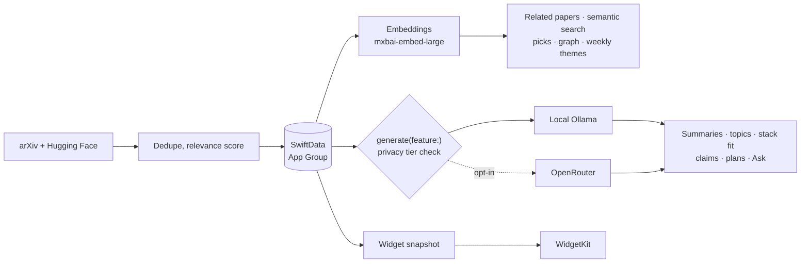

# AI Papers

**A private research companion for AI engineers.** Every day it pulls new papers from arXiv and Hugging Face, and tells you which ones matter for *the system you actually run*: whether a paper applies, what you'd change, how much work it is, and whether there's code to start from.

It's a native macOS app. By default all the work happens on your Mac, through a local model via [Ollama](https://ollama.com). There's no account, no telemetry, and no backend. If you want more horsepower, you can opt into a cloud model through [OpenRouter](https://openrouter.ai), and you choose exactly how much reaches it, from nothing to everything.


**Docs:** [Feature guide](docs/FEATURES.md) · [Architecture](docs/ARCHITECTURE.md)

---

## Why it exists

Thousands of AI papers land on arXiv every month. The tools that exist help you find and summarize them, but the question a working engineer actually has is different: **does this apply to my system, and is it worth trying?** AI Papers is built around that question, and around remembering what you've already read, tried, and learned.

---

## Features at a glance

| | |
|---|---|
| **Two sources, no repeats** | Newest arXiv submissions (cs.AI, CL, LG, MA, NE, CV, IR) plus Hugging Face's community-upvoted daily papers. Anything already in your archive is skipped. |
| **Code and weights** | Every paper is checked for a GitHub repo (with stars), Hugging Face models, and datasets. Filter the archive to papers you can actually run. |
| **Fits your stack** | Describe your system once. Each paper gets a verdict (applies / maybe / not for you), the concrete change it suggests, and the effort involved. |
| **Claims ledger** | Headline results from every paper, lined up by benchmark and metric, with arrows where a newer paper beats an older one. Numbers the model invents are dropped. |
| **Implementation plans** | Prerequisites, 4 to 8 checkable steps (smallest experiment first), how to tell it worked, and the risks. Uses the full PDF text when available. |
| **Lab notebook** | Track what you tried and whether it held up, with a running hit rate. |
| **Ask your archive** | A chat that answers from your own papers with citations, or teaches a concept from scratch with typeset equations. |
| **Spaced review** | Save what you learned; questions come back after 1, 3, 7, 16, and 35 days. |
| **Semantic search** | Search by meaning, not just keywords. |
| **Connections graph** | How papers relate across topics, drawn with D3 edge bundling. |
| **Analytics** | A Sankey of your whole archive, pull history, topic trends, relevance distribution. |
| **Weekly digest** | Themes found by clustering, rising terms, what to read first, and wildcards. |
| **Keyboard triage** | Clear the unread queue one key per paper. |
| **In-app reader** | Full PDFs, cached locally, readable offline. |
| **Widgets** | Small, medium, and large desktop widgets that open straight to a paper. |
| **Export** | Markdown with front matter, ready for Obsidian. |
| **Offline mode** | Everything except pulling new papers works without a connection. |

Every one of these is documented screen by screen in the **[feature guide](docs/FEATURES.md)**.

---

## A tour

### Archive and paper detail

Every paper you've pulled, grouped by topic, searchable by keyword or meaning, filterable by topic, status, date, and code availability. Selecting a paper opens it in an inspector with its summary, stack verdict, claims, implementation plan, related papers, and your own notes.


### Ask your archive

Press ⌘K anywhere. Questions about your papers are answered **only** from the papers you've saved, with numbered citations you can click. "What is X?" questions get a structured explanation: one-line idea, why it exists, an intuition (and where it breaks), how it works, a worked example, a common misconception, and a check-yourself question with the answer hidden. A small on-device classifier decides which mode you meant; `/ask` and `/explain` force it.

| Explaining a concept | Answering from your papers |
|---|---|
|  |  |

### Lab

The engineering workbench: **Fit** (papers that apply to your stack), **Claims** (the ledger), **Plans** (implementations in progress), **Notebook** (what you tried and how it went), and **Review** (spaced repetition).


| Plans | Notebook |
|---|---|
|  |  |

### Graph

Papers on a ring grouped by area, topic, and subtopic, joined to their nearest neighbours by abstract similarity. Hover a paper, topic, or bridge to follow its links; the side panel lists the strongest bridges between topics.


### Analytics

Data mining over your own archive, no model calls: a four-level Sankey (area → topic → subtopic → read status), papers pulled per day, top topics, relevance distribution, and week-over-week trending topics. Re-categorize the whole archive with the local model from here.


### Trend Brief

The week in a minute: one bottom line, three papers to read first, themes found by k-means over embeddings (each with keywords and a paper to start with), rising terms, and wildcards.


### Triage

One paper at a time, most relevant first. **J/K** skip and back, **R** read, **Q** queue for later, **F** favorite, **S** summarize, **P** full paper, **O** arXiv.


---

## Privacy, your call

Everything runs on your local Ollama model by default; nothing leaves your Mac. **Settings → Cloud & privacy** has one picker:

| | Local only (default) | Cloud for paper analysis | Cloud for everything |
|---|---|---|---|
| Summaries | local | cloud | cloud |
| Claims | local | cloud | cloud |
| Implementation plans | local | cloud, or local if your stack is set | cloud |
| Ask and /explain | local | local | cloud |
| Stack fit | local | local | cloud |
| Classification, digest, picks, trend brief | local | local | local |

"Cloud for paper analysis" only ever sends paper titles and abstracts. Your stack description, your questions, and your notes stay on the Mac unless you pick the top tier. The cloud path goes through [OpenRouter](https://openrouter.ai), which fronts hundreds of models (including free ones) behind one key, so you choose the model too. The key is kept in the Keychain and sent as a header, never written to a file or a URL.

---

## How it's built

SwiftUI, SwiftData, and WidgetKit, in Swift. Two small bundled web views: D3 for the connections graph and KaTeX for equations, both loaded from the app bundle, never from the network.



Model output is treated as untrusted. Titles, authors, dates, and IDs always come from the source. Topics snap to a fixed taxonomy. Verdicts must be one of the allowed values. Claim numbers must appear in the abstract. Broken JSON gets one retry, then a visible error. Ranking stays deterministic; the model's opinion is one signal, never the whole decision.

Full details, diagrams, storage layout, and the trust rules: **[ARCHITECTURE.md](docs/ARCHITECTURE.md)**.

---

## Requirements

- macOS 26.5 or later, Apple silicon recommended.
- [Ollama](https://ollama.com/download). On first launch the app checks for it and offers to download the two models it uses: `gemma4` for text and `mxbai-embed-large` for embeddings (a one-time download of a few GB). Any installed model can be picked in Settings.
- An internet connection only for pulling new papers and PDFs (and for the cloud tier, if you turn it on).

## Build and run

```sh
git clone https://github.com/Diem0n/ai_papers.git
cd ai_papers
./install.sh          # builds Release and installs to /Applications
```

Or open `AIPapers.xcodeproj` in Xcode and run the `AIPapers` scheme. You'll need to set your own development team for signing.

**Tests:**

```sh
xcodebuild -project AIPapers.xcodeproj -scheme AIPapers test
```

The tests cover model-output validation, the query router, privacy tier routing, arXiv parsing, deduplication, relevance scoring, and the review schedule. None need Ollama or a network connection.

## Getting started

1. Launch the app. The setup assistant checks Ollama and the models.
2. Optionally describe your stack (Settings → Your stack). Every paper will be judged against it.
3. Press **Refresh** on the Dashboard to pull today's papers.
4. Open a paper, or go to **Triage** and work through the queue from the keyboard.
5. Press ⌘K to ask your archive anything.

## Keyboard shortcuts

| Shortcut | Action |
|---|---|
| ⌘1 to ⌘7 | Dashboard, Archive, Graph, Analytics, Lab, Trend Brief, Triage |
| ⌘K | Ask your archive |
| ⌘, | Settings |
| J K R Q F S P O | Triage actions |
| Space, 1, 2 | Review: show answer, forgot, remembered |

---

## Project layout

```
AIPapers/
├── App/           Entry point, menus, URL scheme
├── Models/        Paper (SwiftData)
├── Services/      Sources, pipeline, Ollama/OpenRouter, embeddings, analysis, export
├── Storage/       SwiftData container and migrations, JSON stores, widget snapshot
├── Utilities/     App state, settings, privacy tiers, taxonomy, Keychain
├── Views/         One file per screen plus shared components
└── Resources/     Bundled D3 and KaTeX
AIPapersWidget/    Widget extension
AIPapersTests/     Unit tests
docs/              Feature guide, architecture, screenshots
```

## Known limitations

- Local generation speed depends on your Mac and model; stack-fit and claims batches run at roughly 2 to 6 seconds per paper.
- Free cloud models on OpenRouter are often rate-limited; the app says so plainly rather than retrying forever.
- The question router is a small classifier and occasionally picks the wrong mode for unusual phrasing. `/ask` and `/explain` override it.
- Small local models can still get technical details wrong in explanations. Treat them as intuition, and check specifics.

## Licence

[MIT](LICENSE).

## Data sources and licences

- Paper metadata and PDFs: [arXiv](https://arxiv.org). Thank you to arXiv for use of its open access interoperability. PDFs are cached only on your Mac.
- Daily papers and code, model, and dataset links: the [Hugging Face](https://huggingface.co/papers) public API.
- Optional cloud inference: [OpenRouter](https://openrouter.ai), opt-in only.
- Bundled libraries: [D3](https://d3js.org) (ISC) and [KaTeX](https://katex.org) (MIT).
- Models are downloaded by Ollama, or routed through OpenRouter, under their own licences. None are bundled.
