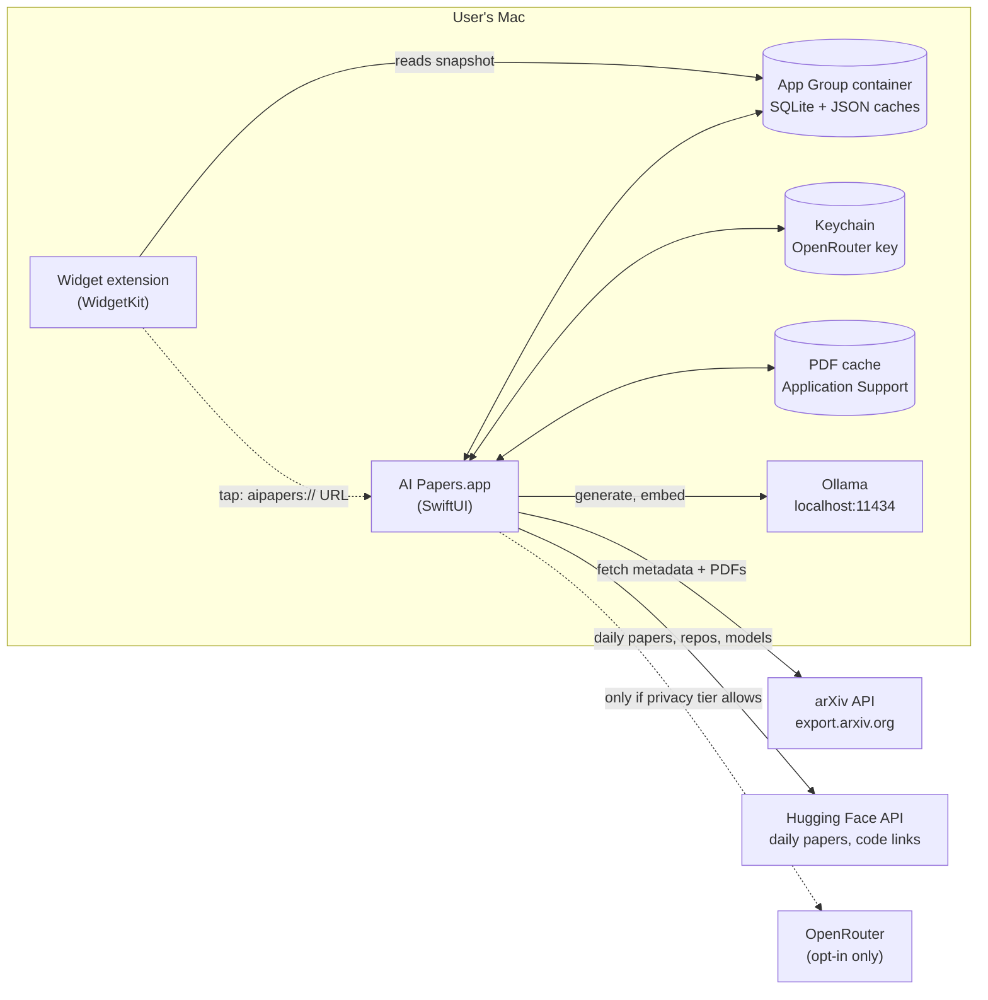
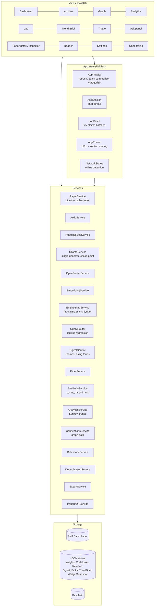
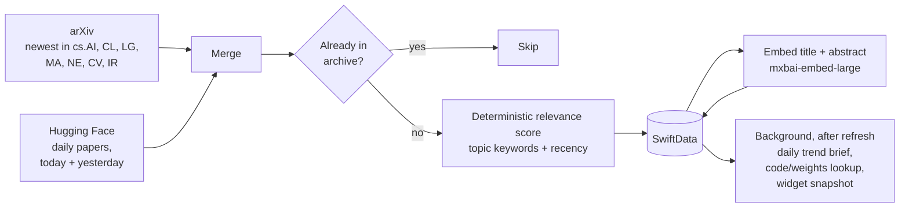
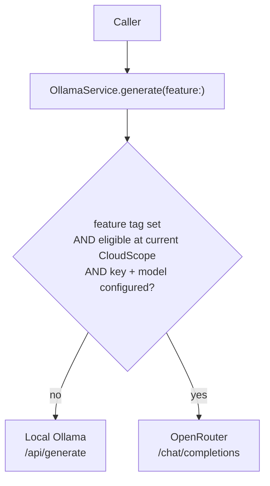
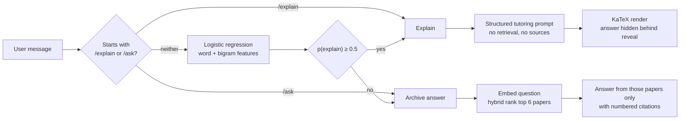
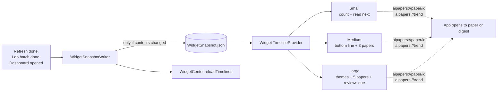

# Architecture

AI Papers is a native macOS app (SwiftUI, SwiftData, WidgetKit) with no backend of its own. Everything it knows lives on the user's Mac. It talks to three kinds of things over the network: paper sources (arXiv, Hugging Face), a local model server (Ollama on `localhost:11434`), and, only if the user opts in, a cloud model gateway (OpenRouter).

This document covers how the pieces fit together, where data lives, and the rules that keep model output honest.

---

## System context



The widget never makes network calls or runs a model. The app prepares a small JSON snapshot; the widget only renders it.

---

## Layers



Responsibilities stay separated: views never make HTTP calls, services never touch SwiftUI, and the widget only reads.

---

## The refresh pipeline



Either source can fail without failing the refresh; only both failing is an error. Embeddings run eagerly because they're cheap and everything downstream (related papers, semantic search, picks, graph, weekly themes) needs broad coverage. Summaries, classification, fit, claims, and plans run on demand or in user-started batches.

---

## Model routing and privacy tiers

Every text-generation call goes through one function, `OllamaService.generate(prompt:json:contextTokens:feature:)`. Each call is tagged with the feature it serves; that tag is checked against the user's privacy tier before anything leaves the Mac.



| Feature tag | Local only | Cloud for paper analysis | Cloud for everything |
|---|---|---|---|
| `summaries` | local | cloud | cloud |
| `claims` | local | cloud | cloud |
| `plan` (no stack set) | local | cloud | cloud |
| `plan` (stack set) | local | **local** | cloud |
| `explainAsk` | local | local | cloud |
| `stackFit` | local | local | cloud |
| untagged: classification, digest narrative, picks, trend brief | local | local | local |

A plan prompt embeds the user's stack description when one exists, so it's promoted to the `stackFit` tier (`EngineeringService.planFeature(stackIsEmpty:)`). This is covered by a regression test.

The OpenRouter key is stored in the Keychain and sent as a header, never as a URL query parameter (query strings end up in system logs on network errors).

---

## Ask: question routing



The router is trained at first use from about 120 labelled examples in `RouteTrainingData.swift`; editing that file is how a misroute gets fixed.

---

## Data model and storage

| What | Where | Format |
|---|---|---|
| Papers (metadata, summary, topic, subtopic, embedding, read/favorite, status, notes, tried-it outcome) | App Group `AIPapers.sqlite` | SwiftData `Paper` |
| Stack fit, claims, implementation plans, plan progress | App Group `Insights.json` | JSON |
| Code / weights / dataset links per paper | App Group `CodeLinks.json` | JSON |
| Spaced-review cards | App Group `ReviewCards.json` | JSON |
| Weekly digest narrative | App Group `DigestNarrative.json` | JSON |
| Picks for you | App Group `PicksCache.json` | JSON |
| Daily trend brief history | App Group `TrendBriefHistory.json` | JSON |
| Widget snapshot | App Group `WidgetSnapshot.json` | JSON |
| Downloaded PDFs | `~/Library/Containers/…/Application Support/AIPapers/PDFs/` | PDF |
| OpenRouter API key | Keychain | generic password |
| Settings | sandboxed UserDefaults | plist |

Model-written insights live in JSON beside the database, not as SwiftData properties. That keeps the schema small and means regenerating or clearing insights never risks a migration.

Schema changes to `Paper` need a matching `ALTER TABLE` in `StoreMigration.addColumnsIfNeeded` (`Storage/SharedModelContainer.swift`); SwiftData can't migrate a custom-URL store on its own and crashes instead.

---

## Trust rules for model output

| Rule | Enforced in |
|---|---|
| Title, authors, dates, IDs, URLs always come from the source, never the model | `PaperService`, `ArxivService`, `HuggingFaceService` |
| Topics and subtopics snap to the fixed taxonomy; anything else is dropped | `OllamaService.classify`, `canonicalTopics` |
| Stack-fit verdict must be `applies`, `maybe`, or `no`; effort must be one of four values | `EngineeringService.parseFit` |
| A claim is kept only if every number in it appears in the abstract | `EngineeringService.parseClaims` |
| A plan needs at least two steps; long fields are capped | `EngineeringService.parsePlan` |
| LaTeX backslashes inside JSON are escaped before decoding | `EngineeringService.jsonData` |
| Broken JSON gets one automatic retry, then a visible error | `EngineeringService.generateValidated` |
| Ollama HTTP 5xx (model swapping) or a dropped connection gets one retry after 2 s; "isn't running" is only reported if Ollama doesn't answer at all, otherwise "busy" | `OllamaService.generate`, `isReachable` |
| Ranking is deterministic; the model's relevance estimate is at most 20% of the score | `RelevanceService.score` |

---

## Analytics and data science

None of these call a model:

| Feature | Technique |
|---|---|
| Weekly themes | k-means over embeddings (farthest-first init), cluster label from taxonomy mode |
| Theme keywords | TF-IDF over title + abstract, part-of-speech filtered with `NaturalLanguage` |
| Rising terms | Term lift: recent window frequency vs. prior window |
| Wildcard papers | Nearest-neighbour isolation in embedding space |
| Semantic search | Reciprocal rank fusion of cosine similarity and keyword overlap |
| Picks for you | Weighted taste vector (favorites > done > reading > opened), cosine to unread, 2-per-topic diversity cap |
| Connections graph | Each paper's 3 nearest neighbours above 0.6 cosine, laid out by D3 hierarchical edge bundling |
| Sankey | Area → Topic → Subtopic → Read status counts |
| Trending topics | Last 7 days vs. prior 7 days per topic |
| Claims ledger | Group by (benchmark, metric), detect lower-is-better metrics by name, mark rows that beat an earlier paper's best |

---

## Widget



The app and widget each keep their own copy of the `WidgetSnapshot` types (app target: `Storage/WidgetSnapshot.swift`; widget target: `AIPapersWidget/WidgetSnapshot.swift`). They must stay in sync.

---

## Offline behavior

`NetworkStatus` watches the network path and the "Work offline" setting. When offline:

- Refresh is disabled and the launch-time pull is deferred until the connection returns.
- Code-link lookups and PDF downloads are skipped; already-downloaded PDFs still open.
- Everything else (search, Ask, summaries, Lab, graph, analytics) keeps working against local data and Ollama.

---

## Tests

`AIPapersTests` covers the pure logic that model output and ranking depend on: fit/claims/plan validation, LaTeX-in-JSON handling, the query router, privacy tier eligibility (including the plan/stack regression), GitHub-link detection, the review schedule, deduplication, relevance scoring, and arXiv feed parsing with a stubbed URL protocol (including a malformed feed). No test needs a running Ollama or network.

```sh
xcodebuild -project AIPapers.xcodeproj -scheme AIPapers test
```

---

## Source map

```
AIPapers/
├── App/                AIPapersApp.swift (scenes, Go menu, ⌘K), Info.plist (aipapers:// scheme), entitlements
├── Models/             Paper.swift (SwiftData)
├── Services/           ArxivService, HuggingFaceService, PaperService, OllamaService, OpenRouterService,
│                       EmbeddingService, EngineeringService, QueryRouter, DigestService, PicksService,
│                       SimilarityService, AnalyticsService, ConnectionsService, RelevanceService,
│                       DeduplicationService, TrendBriefService, ExportService, PaperPDFService, OllamaSetup
├── Storage/            SharedModelContainer (+ migrations), PaperRepository, JSONFile and the JSON stores,
│                       WidgetSnapshot writer
├── Utilities/          AppActivity, AskSession, LabBatch, AppRouter, NetworkStatus, AppSettings, CloudScope,
│                       KeychainService, Taxonomy, ReadingStatus, RouteTrainingData, AppSection
├── Views/              One file per screen plus shared pieces (DesignSystem, PaperInspector, PaperRowView,
│                       SankeyView, ExplanationView, ConnectionsWebView, PixelEyeLogo)
└── Resources/          connections.html + d3.min.js, explanation.html + KaTeX (bundled, never fetched)
AIPapersWidget/         Widget views, timeline provider, snapshot types
AIPapersTests/          Unit tests
```
