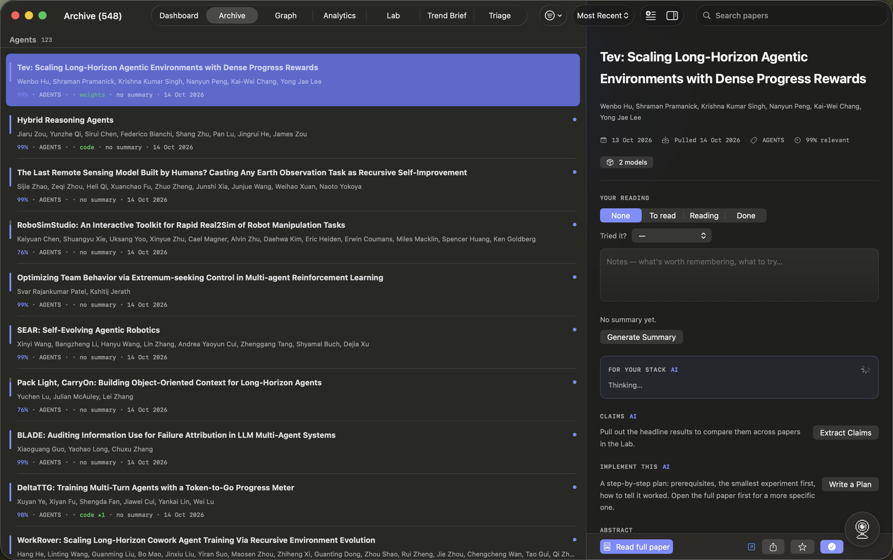
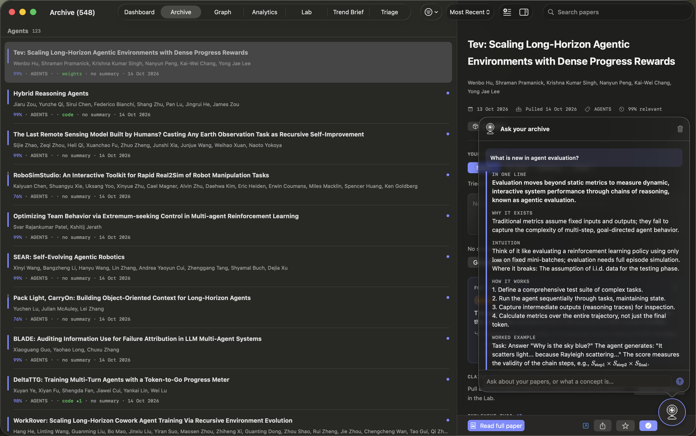
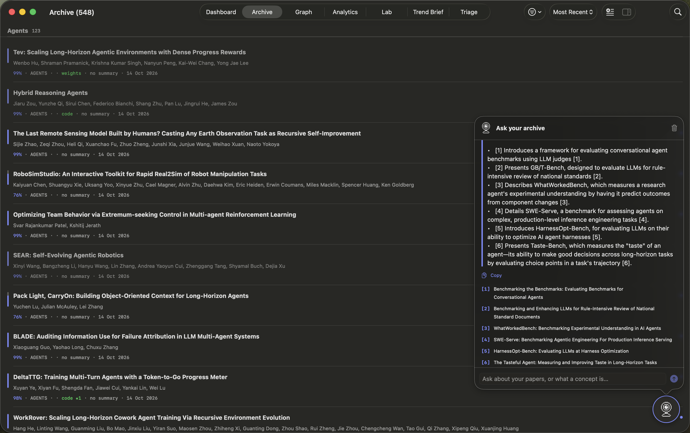

# Feature guide

A screen-by-screen guide to everything in AI Papers. For how it works under the hood, see [ARCHITECTURE.md](ARCHITECTURE.md).

**Contents:** [Dashboard](#dashboard) · [Archive](#archive) · [Paper detail](#paper-detail) · [Full-paper reader](#full-paper-reader) · [Ask your archive](#ask-your-archive) · [Graph](#graph) · [Analytics](#analytics) · [Lab](#lab) · [Trend Brief](#trend-brief) · [Triage](#triage) · [Widgets](#widgets) · [Settings](#settings) · [First-run setup](#first-run-setup) · [Export](#export) · [Offline mode](#offline-mode) · [Keyboard shortcuts](#keyboard-shortcuts)

---

## Dashboard

The home screen, laid out as a bento grid that fills the window.

| Card | What it shows |
|---|---|
| **Stats row** | Total papers, unread, summarized, favorited. Click any tile to jump to the Archive. |
| **Top unread** | Highest-ranked unread papers. Papers judged to apply to your stack rank first; papers judged not relevant sink. |
| **Picks for you** | Five unread papers chosen from what you've favorited, read, and finished, each with a one-line reason. With no reading history yet it falls back to the most relevant unread papers, at most two per topic. **Re-pick** asks again. |
| **Top topics** | Bar chart of your five biggest topics. |
| **Trending** | Topics growing fastest this week compared with last week. |
| **Trend brief** | The week's bottom line, the top themes with paper counts, rising terms, and the first papers to read. **View all** opens the full Trend Brief. |
| **Ask your archive** | The chat, inline. Suggested questions come from your own topics. See [Ask your archive](#ask-your-archive). |

The toolbar has **Refresh** (pull new papers; becomes **Pause** while running) and a toggle for the paper-detail inspector. Clicking any paper opens it in the inspector on the right without leaving the dashboard.

---

## Archive

Every paper you've ever pulled, grouped under collapsible topic headers (biggest group first, with counts).

**Each row shows:** a relevance bar, title, authors, relevance %, topic, whether code or weights exist (with GitHub stars), whether it's summarized, the date pulled, and markers for unread, favorite, reading status, and notes.

**Search** (⌘F or the search field) has two modes, chosen from the scope bar:

- **Keyword**: matches title, authors, topic, and your notes.
- **Meaning**: semantic search. Type what you're after in plain words ("ways to cut KV-cache memory") and press Return. Results are ranked by a fusion of embedding similarity and keyword overlap, with a match percentage on each row.

**Filter menu:** topic (nested by area), reading status (to read / reading / done), date pulled (today / this week / this month), unread only, favorites only, has code or weights. **Clear Filters** resets everything.

**Sort:** most recent, relevance, or unread first.

**Generate Summaries (n)** summarizes every paper still missing one, in the background, with a progress banner that survives switching pages.

---

## Paper detail

Opens in an inspector panel on the right of Dashboard, Archive, Graph, Lab, and Trend Brief.

| Section | What it does |
|---|---|
| **Header** | Title, authors, published date, date pulled, topic, relevance. |
| **Availability** | **Code** button (GitHub repo, with stars), **models / datasets** button (Hugging Face), community upvotes. Says so plainly when nothing public exists yet. |
| **Your reading** | Status (none / to read / reading / done), **Tried it?** (want to try / trying / worked / didn't work), and free-form notes. Notes are searchable. |
| **Summary / Why it matters** | AI-written, marked "AI". **Generate Summary** if there isn't one yet; failures show the real reason (Ollama down, cloud rate limit, bad key). |
| **For your stack** | Verdict (applies to you / maybe / not for your stack), the concrete change it suggests, and effort (config change, code change, retraining, research). Generated automatically on open once you've described your stack. |
| **Claims** | The headline results, with benchmark, metric, and value. Numbers are kept only if they appear in the abstract. |
| **Implement this** | A step-by-step plan: what you'll need, 4 to 8 checkable steps (smallest experiment first), how to tell it worked, what to watch out for. Uses the full paper text once you've opened the PDF. Tick steps off as you go; progress shows in the Lab. |
| **Abstract** | The original abstract. |
| **Related papers** | The three nearest papers by embedding similarity, with scores. Click to jump. |

**Bottom bar:** **Read full paper**, open on arXiv, export to Markdown, favorite, mark read. Each AI section has a ↻ to regenerate.

---

## Full-paper reader

**Read full paper** (or **P** in Triage) downloads the PDF from arXiv once, saves it locally, and opens it in its own window with PDFKit. After that it opens instantly and works offline. **Show in Finder** reveals the saved file.

---

## Ask your archive

| Explain a concept | Ask about your papers |
|---|---|
|  |  |

Available as a card on the Dashboard, and as a floating eye button in the bottom-right of every other page (⌘K toggles it). The conversation is shared between the two, so an answer in progress survives switching pages.

Every message is routed to one of two modes:

**Archive answers.** Your question is embedded, the six most relevant papers are retrieved by hybrid ranking, and the model answers **only** from those papers with numbered citations like [1]. Click a citation to open that paper. If your papers don't cover it, it says so.

**Concept explanations.** For "what is X" questions. The model teaches the concept in eight fixed sections, built from learning-science findings:

1. **In one line**: plain language first, then the precise term.
2. **Why it exists**: the problem it solves.
3. **Intuition**: an analogy from ML you already know, plus where the analogy breaks.
4. **How it works**: 3 to 5 numbered steps.
5. **Worked example**: small numbers you could trace by hand.
6. **Common misconception**: what people get wrong.
7. **Check yourself**: a question that makes you apply the idea.
8. **Answer**: hidden behind **Show the answer** so you try first.

Equations render with KaTeX. **Save for review** turns the check question into a spaced-review card (see [Lab → Review](#review)).

**Routing:** a small logistic-regression classifier decides between the two modes from your wording. Force it with `/explain <concept>` or `/ask <question>`.

**Every answer** has a **Copy** button (plain text) and a **Clear** button for the thread.

---

## Graph

How your papers connect, drawn with D3 hierarchical edge bundling.

- Papers sit on a ring, grouped by **area → topic → subtopic**, with a colored arc and label per topic.
- A line joins papers whose abstracts are similar (each paper's 3 nearest neighbours). Links bundle along the category tree, so topics with many shared links form visible bundles.
- Dot size is relevance; read papers are dimmed; favorites get a gold ring.

**Left panel:** paper and link counts, percentage of links that cross topics, and the **strongest bridges between topics** (e.g. "Agents ↔ LLM 22").

**Interactions:** hover a paper to light up only its links and list what it connects to; hover a topic, bridge, or legend area to follow that group's links; click a paper to open it in the inspector.

**Controls:** a similarity threshold slider and **Only links across topics**.

---

## Analytics

Data mining over your own archive. No model calls.

| Section | What it shows |
|---|---|
| **Stats** | Total papers, unread, % summarized, days of activity. |
| **Flow: Area → Topic → Subtopic → Read status** | A Sankey diagram of the whole archive, four levels deep, with labelled counts at every node. |
| **Papers pulled over time** | Daily bar chart of new papers. |
| **Top topics** | Your largest topics. |
| **Relevance distribution** | How relevance scores spread across the archive. |
| **Trending topics** | Last 7 days vs. the prior 7, with the change per topic. |

**Categorize with LLM** (toolbar): classify new papers into the fixed taxonomy, or **Re-categorize all** (asks first; your notes and read state aren't touched). Stoppable while running.

---

## Lab

The engineering workbench: five panes.

### Fit

Papers judged against your stack, split into **Applies to you** and **Maybe**, each with the suggested change and an effort badge. **Assess 25 more** runs the most relevant unread papers through the model in the background (about 2 to 3 seconds each locally). Needs a stack description in Settings first; if you change your stack, old verdicts are marked stale and re-judged.

### Claims

The claims ledger: results from every paper, grouped by benchmark and metric, newest first. **↑** marks a result that beat an earlier paper's best on the same benchmark; the best value is highlighted. Lower-is-better metrics (error, loss, latency, perplexity, MAE, etc.) are detected by name. **Extract from 25 more** runs the batch.

### Plans

Every implementation plan you've started, with a progress ring, the next unchecked step, and the paper's tried-it outcome.

### Notebook

Your lab notebook: papers grouped by **want to try / trying / worked / didn't work**, with your notes and a running hit rate ("1 worked, 0 didn't, 100% of what you finished trying held up"). **Export Notebook…** writes them all to Markdown.

### Review

Spaced review of concepts saved from `/explain`. One card at a time: read the question, recall, **Show Answer** (Space), then **Forgot** (1) or **Remembered** (2). Remembered cards come back after 1, 3, 7, 16, then 35 days; forgotten cards come back in ten minutes. The tab shows how many are due.

---

## Trend Brief

The weekly digest, built to be read in a minute or two:

- **The bottom line**: one sentence for the week.
- **Read these first**: three papers, picked for relevance and coverage.
- **This week's themes**: clusters found with k-means over embeddings, each with a label, keywords, paper count, the most representative paper to start with, and the rest one click away. A model writes a headline, takeaway, and "so what" per theme on top.
- **Rising terms**: phrases appearing much more this week than before.
- **Wildcards**: papers unlike anything else you've pulled.
- **Full narrative**: the longer model-written daily brief, collapsed by default.

**Rewrite Summaries** regenerates the model-written parts. The numbers themselves are deterministic.

---

## Triage

Clear the unread queue from the keyboard, one paper at a time, most relevant first. The queue is fixed when you open the page so papers don't shuffle under you.

| Key | Action |
|---|---|
| **J** or **→** | Skip (leave unread) |
| **K** or **←** | Back |
| **R** | Mark read, next |
| **Q** | Queue for later (To read), next |
| **F** | Favorite |
| **S** | Generate summary |
| **P** | Read the full paper |
| **O** | Open on arXiv |

Each card shows relevance, topic, subtopic, date, your stack verdict and code availability if known, the summary, and the abstract.

---

## Widgets

Desktop and Notification Center widgets in three sizes, all reading a snapshot the app prepares (the widget never runs a model or touches the network):

- **Small**: papers new today and the one to read next.
- **Medium**: the week's bottom line and three papers, with topic, stack verdict, and a code badge.
- **Large**: bottom line, top themes, five papers with why they matter, and how many review cards are due.

Tap a paper to open it in the app; tap elsewhere to open the Trend Brief.

---

## Settings

Open with ⌘,.

| Section | Options |
|---|---|
| **Your stack** | Describe what you build and run. Every stack verdict and tailored plan uses it. |
| **Navigation** | Sidebar or top tabs; show sidebar by default. |
| **Sections** | Show or hide any page. |
| **Fetching** | Papers per refresh (10 to 200), include Hugging Face daily papers, work offline. |
| **Summarization** | Which installed Ollama model writes summaries and classifications. |
| **Cloud & privacy** | Privacy tier (local only / cloud for paper analysis / cloud for everything), OpenRouter API key (stored in Keychain), and a cloud model picked from OpenRouter's live list of free models. Each tier spells out exactly what leaves your Mac. |
| **Ask** | Which local model answers Ask, /explain, and the Lab. A bigger model is more accurate but slower. |
| **Topics** | The topic vocabulary used for relevance scoring. |

**Privacy tiers in detail:**

| | Local only | Cloud for paper analysis | Cloud for everything |
|---|---|---|---|
| Summaries | local | cloud | cloud |
| Claims | local | cloud | cloud |
| Implementation plans | local | cloud, unless your stack is set (then local) | cloud |
| Ask and /explain | local | local | cloud |
| Stack fit | local | local | cloud |
| Classification, digest, picks, trend brief | local | local | local |

---

## First-run setup

On first launch (and from **AI Papers → Setup Assistant…**):

1. **Local model**: checks Ollama is running and that the two models the app needs are installed. If not, links to the Ollama download, or downloads the missing models with a progress bar.
2. **Your stack** (optional): describe your system so papers are judged against it from the start.

---

## Export

Any paper, or the whole notebook, exports as Markdown with YAML front matter (title, arXiv ID, URL, authors, date, topic, subtopic, status, tried-it outcome, code link, tags). A folder of them drops straight into Obsidian. Sections: your notes, summary, why it matters, stack fit, claims, implementation plan with checkboxes, abstract. Model-written sections are labelled "(AI)".

---

## Offline mode

Turns on automatically when there's no network, or manually with **Settings → Fetching → Work offline**. A banner says so. Pulling papers, code lookups, and new PDF downloads pause; everything else (search, Ask, summaries, Lab, graph, analytics, already-downloaded PDFs) keeps working. If the launch-time refresh was skipped, it runs when you're back online.

---

## Keyboard shortcuts

| Shortcut | Action |
|---|---|
| ⌘1 to ⌘7 | Dashboard, Archive, Graph, Analytics, Lab, Trend Brief, Triage |
| ⌘K | Ask your archive |
| ⌘, | Settings |
| ⌘F | Search (Archive) |
| J K R Q F S P O, ← → | Triage (see [Triage](#triage)) |
| Space, 1, 2 | Review: show answer, forgot, remembered |
